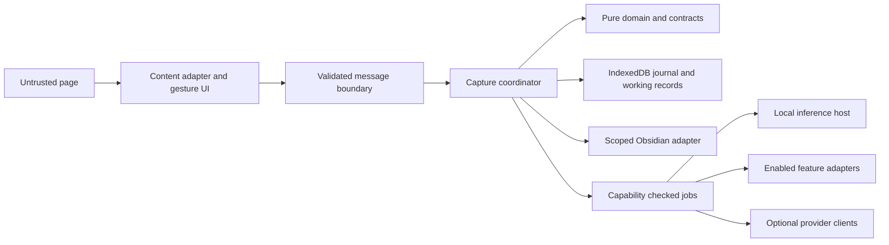

# Architecture and component contracts

This is the target implementation design. The current extension uses a single TypeScript package and static composition. [IMPLEMENTATION.md](IMPLEMENTATION.md) maps the shipped modules and simplifications; [STATUS.md](STATUS.md) records observed evidence. Planned contracts and optional integrations below are not all implemented.

## Ownership and dependency direction

| Location | Owns | May depend on |
| --- | --- | --- |
| src/core/domain | Capture identity, lifecycle, gesture decisions, pure policies | Standard language primitives and core contracts |
| src/core/contracts | Versioned schemas, commands, events, port interfaces, typed outcomes | A small runtime schema library where needed |
| src/application | Capture coordinator, journal execution, reconciliation, feature/job lifecycle | Core and injected ports |
| src/adapters/browser | Chrome messages, storage, tabs, permissions, content extraction and viewport capture | Core contracts and narrow application entry points |
| src/adapters/persistence | IndexedDB transactions, migrations, vault repository | Core ports and validation |
| src/adapters/inference | Embedding implementation and runtime-host lifecycle | Embedding port and model configuration |
| src/features/image, file, youtube, gaze, haunting, cloud, jev, resurrection, chat, recording | Feature-specific extraction, UI behavior, or enrichment | Declared core ports; no sibling implementations |
| src/ui | Hand, options, graveyard, status and accessibility controls | Read models and commands; no direct persistence or provider SDKs |
| src/bootstrap | Registry and dependency wiring for each extension entry point | All approved implementations |

Enforce these imports in M0. A feature must not reach around a port to read credentials, write the vault, mutate IndexedDB, or send an unrestricted request. The application remains the only writer of capture lifecycle state. Prefer direct typed calls and a few explicit events over an opaque global event bus.

Use a closed registry of bundled features. Adding a capability is a code change reviewed with its permissions and tests. There is no remote plugin loader or runtime code evaluation.

## Stable contracts

Implement and runtime-validate these contracts before adding integrations:

| Contract | Required information and behavior |
| --- | --- |
| FocusPoint | Viewport x/y, source mouse/gaze, timestamp, tab/frame/document identity, navigation generation; confidence only when meaningful |
| CaptureCandidate | Kind, bounded content snapshot, canonical source, target rectangle, source metadata and candidate identity; never a vault path or request headers |
| CaptureCommand | Operation ID, candidate ID, verified active document, capability epoch and user confirmation; video time frozen at confirmation |
| CaptureRecord | Schema version, stable capture ID, immutable raw evidence, content revision, lifecycle revision, current save outcome and namespaced optional metadata |
| CaptureOutcome | Separate persistence status (queued-local, saved-vault, uncertain, conflict, failed) from preservation kind (text, file, screenshot, link); include actual retained content and retryability |
| TranscriptResult | available, partial, unavailable, permission-required, failed; video/track/language identity, actual cues, completeness and provenance |
| EnrichmentResult | Capture ID, input content hash/revision, feature epoch, provenance, bounded proposed additions; no lifecycle mutation |
| FeatureStatus | available, disabled, permission-required, initializing, ready, failed; a reason and a cleanup owner |

Messages carry a schema version and operation identifier. Background code derives sender identity from Chrome's sender metadata, not fields supplied in the message. Match document/frame/navigation identity against the armed capture and discard stale results. Reject oversized or unknown commands explicitly. Output descriptions from pages and models are data, not authority to request another action.

Small ports include CaptureRepository, OperationJournal, VaultRepository, MediaFetcher, Snapshotter, Embedder, TranscriptReader, ProviderGateway, PermissionBroker, and Clock. Each exposes typed outcomes and cancellation. Do not expose generic fetch(url, headers), arbitrary filesystem writes, or Chrome objects through a feature API.

## Gesture and hand behavior

The input controller recognizes idle → arming → armed → confirming → confirmed, with explicit cancellation and expiry. The hand renders those states; animation completion cannot mark a note saved.

A trusted lone Shift or Control hold starts a bounded lasso; it does not issue a capture capability yet. Fit the circle/oval around its own centre so users can begin on the rim. Show the sentence or selected passage at that centre using its actual text rectangles. Only a sufficiently closed, directional loop issues ARM followed by CAPTURE. Releasing the modifier early, scrolling, dragging, typing, a modifier chord or losing focus cancels the unfinished gesture. One continuous modifier hold can confirm only one capture; releasing after confirmation does not cancel a delayed ARM/save.

A deliberate shake during that same hold cancels the current gesture or pending operation. For six seconds after acknowledgement, a shake during the original uninterrupted hold can archive that capture. A new hold starts a new target, and ordinary mouse movement never archives anything. Escape and secondary accessible actions use the same lifecycle commands. Ignore synthetic input and editable fields; gesture checks supplement the message boundary, not replace it.

Universal activation is a persisted browser-wide choice behind an optional all-sites grant in the full profile, required for Chrome image crops on new tabs; the core profile uses optional HTTP(S) grants. Actual injection and capture remain HTTP(S)-only. Active-tab and completed-navigation events wake the content entry only after checking activation intent, live permissions and excluded origins; protected Chrome pages remain unavailable. Pause disables new page commands immediately and removes existing overlays. Original image-download intent is a separate exact-origin allowlist.

The page UI is a single hand icon in the corner. During a capture a one-line status grows to its left, with only the buttons the moment needs (Cancel, Spit back, Connect vault when no vault is connected); the hand sits at the bar's right end, so it never moves under the pointer, and the bar goes quiet after six seconds (twelve after an error) unless keyboard focus is inside it. Everything else (grab selection or page, on/pause, vault status, Settings, the graveyard and help) lives in the toolbar popup, which reaches the page only through the trusted `GRAB_ACTIVE_TAB` message: the background wakes the active tab and asks its top frame to grab, and the popup shows the page's reason if nothing was taken. A settled, non-editable text selection grows a one-click chip at its end. Clicking the hand grabs the selection when there is one, otherwise the page. At capture time `ui/grave.ts` cracks the page open below the target. One of three filmed zombie hands, picked at random and never the same twice running, punches through and slaps flat. It closes its fist on a paper copy of the words (in the page's own type and colours) or on the page peeled into a card, which tears free with a ragged edge, lifts and crumples into a ball in the fist (`ui/paper.ts`, a pure model of the bent sheet that the view cuts into shaded facets), then yanks it under on a confirmed save or a capture kept on the device while no vault is connected, and lets go when nothing was kept. After a yank the wall mends: footage of it bursting open into the same hole plays backwards, so the plaster flies back in and its cracks close into the page. That heal is matted onto each take and packed after its frames. The hands are generated footage matted against its own wall (`scripts/hand/README.md`), sized from the page's font. Each is packaged as its WebP frames packed back to back, each frame holding the hand beside the wall behind it; the page multiplies the wall by its own background colour before laying the hand over it, so on a dark page the rim, plaster and dust are dark rather than a pale glow. The packs are not web-accessible: when a target is chosen, the content script sends `HAND_SPRITE {hand}`, and the background reads that pack from the extension origin and returns its bytes. The page splits the frames and decodes only a small window around the playing one, with `createImageBitmap`, into a canvas. No URL reaches the page, so its image CSP cannot block the hand and pages cannot probe for the extension. Until the bytes land, the hole opens without the hand. The animation is a pure `poseAt(layout, state)` function stepped at 1.2× the footage's 24 fps at each display frame's own requestAnimationFrame time; each display frame mixes the footage frame into the next by how far the step has come, so the hand moves on every refresh rather than in the footage's own steps; persistence acknowledgements alone decide bury/release/fade, and slow saves fade it within 3.6 seconds while the status stays truthful. Reduced motion shows a static grip; screenshot preparation hides all extension visuals. A page grab is a `link` candidate carrying the title, URL and a bounded (4,000-character) excerpt of visible article/main reading text; navigation, forms, dialogs, editable and hidden content are skipped.

Scrolling/navigation that invalidates a target cancels an unfinished lasso or arming. A gaze adapter supplies the same FocusPoint contract, with calibrated conversion into the active content viewport. Its camera, calibration state, and persistence are feature-owned. Gaze arms; the mouse circle confirms for the planned demo.

## Durable saving and reconciliation

The vault is the durable export: capture notes, attachments, and application lifecycle metadata. IndexedDB is the working database, pending operation journal, and rebuildable vector index. A vector is never the only copy of evidence or archive status.

1. Atomically store the capture snapshot and pending operation in IndexedDB before side effects. The UI can say queued locally, not saved to Obsidian.
2. The coordinator runs one mutation at a time per capture. Every asynchronous task carries the capture/content/lifecycle revision and capability epoch.
3. Generate namespaced paths from trusted configuration and random IDs. Create attachment bytes, the note, and required lifecycle metadata with If-None-Match: *. Never take a destination path from page content. Publish a file outcome only after the actual bytes exist. Saved-vault requires acknowledgement of the note, its required metadata, and any attachment claimed by that outcome; partial progress remains recoverable in the journal.
4. A response timeout means uncertain outcome. Read the deterministic path back and compare it with the journal's expected content/hash. Notes and metadata also carry the application marker and operation ID; binary attachments retain their original bytes and are identified through their generated path, hash and metadata reference. A match acknowledges the write; a mismatch is a conflict. Do not issue an unconditional retry over that path.
5. Record the acknowledgement and remote version in the journal. Resume unfinished work on startup, an appropriate alarm, or user retry. Chrome worker memory is disposable.
6. Write lifecycle and enrichment metadata separately from the user's raw capture body. Updates use the current ETag with If-Match. A 412 produces conflict/reconciliation, never forced replacement. Keep raw evidence and generated descriptions distinguishable.
7. Spit-back changes lifecycle to archived, cancels pending enrichment and removes the capture from active retrieval immediately. Persist that archive status to the vault metadata conditionally. A late save response must finish reconciling the archived capture, not reactivate it.
8. Rebury is an explicit new lifecycle revision. A previous task cannot override it. Rebuild the index from vault notes plus lifecycle metadata, then apply still-pending local lifecycle operations before publishing it. Never erase the journal or pending archive markers during rebuild. Exclude archived, missing, conflicted or unreadable records rather than resurrecting them.

The plugin documents conditional writes; verify support in the actual test vault at M0. If a plugin cannot enforce create-only/conditional writes, show a setup requirement and offer explicit local export while retaining the queue. Do not silently downgrade the normal vault writer. [Obsidian conditional writes](https://github.com/coddingtonbear/obsidian-local-rest-api#conditional-writes)

Browser uninstall or local storage loss can remove unsynced work. The UI must distinguish pending saves and archive sync from vault-confirmed state. Only confirmed vault records and metadata can be recovered after reinstall. Shared transcript companions and attachments are retained when an individual moment is archived; no Undo path deletes vault files.

## Runtime hosts and resources

Use a lightweight background coordinator and a small local embedding implementation behind Embedder. First probe WASM inference in the extension background context with cached model assets. Keep initialization/inference resumable; do not depend on an immortal worker. [Chrome lifecycle](https://developer.chrome.com/docs/extensions/develop/concepts/service-workers/lifecycle)

If a feature needs a DOM or a longer-lived worker host, isolate it behind the same port. Prefer a visible extension page for early gaze calibration. If an offscreen document is needed, one shared host manager owns it and its resource leases: Chrome permits only one offscreen document per normal profile, and its extension API access is limited to runtime messaging. Embedding, gaze, and recording must not each create competing offscreen documents. [Offscreen API](https://developer.chrome.com/docs/extensions/reference/api/offscreen)

A feature's dispose operation stops listeners, observers, timers, camera/media tracks and dedicated workers, releases host leases, and invalidates callbacks. Resource sharing must not cause disabling gaze to terminate an unrelated embedding operation. A whole-extension disable stops all resources.

## Media and retrieval

Images: fetch the loaded image resource through MediaFetcher, validate bytes/type/size, then create a local attachment. If unavailable, Snapshotter captures only the currently authorized visible target after hiding the overlay, accounting for scale, and rechecking the active tab. Restore UI on every path. Keep only the crop. Label screenshot and link-only fallbacks accurately. SVG/HTML and unsupported formats fall back to a safe raster snapshot or link rather than becoming executable previews.

YouTube: begin with watch pages and the viewer's native transcript panel. Capture video identity/time at confirmation; cache captions by video/track/language. Keep cue timestamps, source, and completeness. Include roughly 30 seconds before and 60 seconds after the moment when cues exist; store a full companion transcript when practical. Different moments in one video are distinct captures. Ignore stale responses after in-page navigation. [Native transcripts](https://support.google.com/youtube/answer/15930243?hl=en)

The viewer adapter does not depend on the creator-oriented captions.download API. Missing, partial, unavailable and failed are different outcomes; a missing transcript does not fail the saved moment. Paste/import can supply an explicit alternative without fabricating timestamps. [Caption API permissions](https://developers.google.com/youtube/v3/docs/captions/download)

Embed bounded text sources: raw text, image alt/caption/context, and timestamped transcript chunks. Optional OCR/vision adds a separately attributed text source. Hash input plus model/version and re-embed only on change. Search results join through active capture records at query time so an old vector cannot surface archived content. Retrieved chunks retain links to the exact video moment.

## Adding, disabling and removing a feature

Every registry entry declares its ID, contract version, required ports/capabilities, dependencies, settings schema, startup and disposal behavior, and default off/on state. Enablement is checked centrally both when scheduling work and immediately before a privileged operation; result acceptance checks the epoch again.

- **Add:** implement one module, register it in bootstrap, add only necessary optional permissions, and prove its contract/absent/disabled/failure cases. Existing core files should change only for a deliberate shared contract extension.
- **Disable:** increment the feature epoch, stop new work, abort supported jobs, dispose resources, and suppress stale output. Already transmitted provider data cannot be recalled; the UI must not imply otherwise.
- **Remove from a build:** remove its registry import and any exclusive dependency/permission, then run the core-profile tests. Preserve generic record readers, migrations, and export for saved data from that feature.
- **Replace:** keep the port and contract, substitute an adapter in bootstrap, and run its contract suite. Example: replace the embedding host or vault backend without changing gesture recognition.

Keep schema evolution separate from feature enablement. Preserve unknown optional metadata losslessly. An unsupported future record version opens read-only/exportable with a clear status; do not downgrade or delete it. Settings and capability changes must be observed across all open extension contexts.

## Required architecture checks

M0 installs import-boundary and strict TypeScript checks. Later milestones add message/schema validation, restart/reconciliation tests, media and provider contract tests, and a core-only build/profile. At least one release check must disable each optional module while the text capture → vault → retrieval path still works. Requirements in this document are not evidence that those checks have passed.
